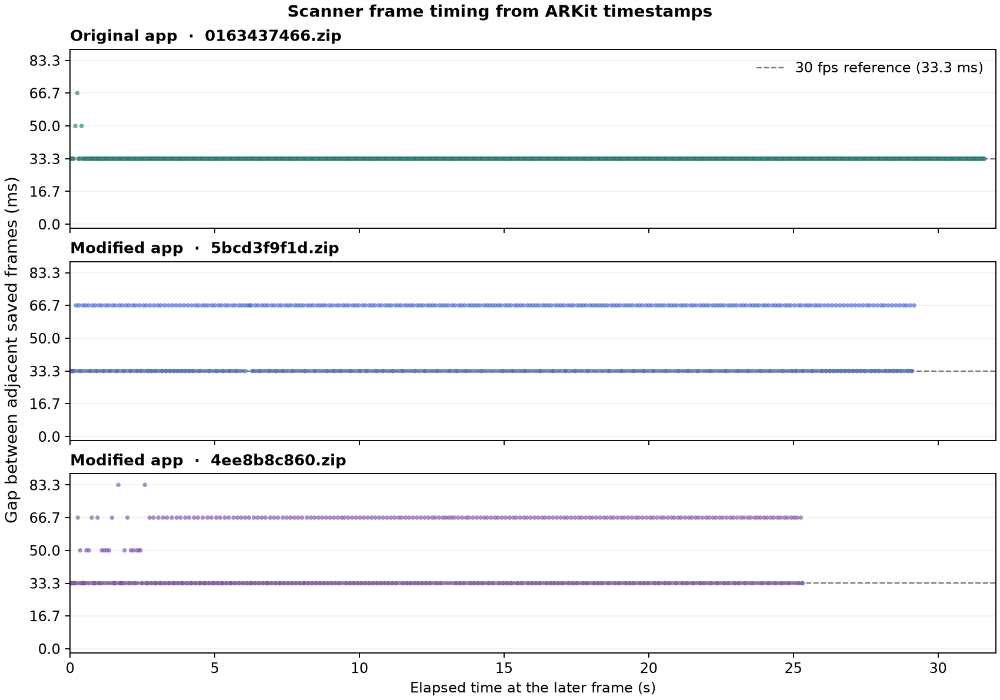

# Scanner frame timing comparison

Codex@M4 compared three recordings using consecutive ARKit timestamps in each export's `odometry.csv`. Each plotted gap is placed at the elapsed capture time of the later frame. The dashed reference is one frame interval at 30 fps.

| Export | App | Saved samples/s from ARKit timestamps | Gaps around 67 ms | Decoded RGB / depth PNGs |
| --- | --- | ---: | ---: | ---: |
| `0163437466.zip` | Original, as reported by Allen | 29.93 | 1 | 946 / 947 |
| `5bcd3f9f1d.zip` | Modified | 21.18 | 257 | 619 / 619 |
| `4ee8b8c860.zip` | Modified | 22.47 | 181 | 570 / 570 |

Gap counts use timestamps rounded to the nearest 16.667 ms. The original MP4 reports 947 frames in stream metadata, while ffprobe emitted 946 decoded frames. Both modified exports had contiguous depth indices matching the decoded RGB counts. All three use 1920 × 1440 HEVC Main at roughly 9.4 Mbps and 256 × 192 16-bit depth PNGs.

The repeated gaps appear in the capture timestamps, which explains the lower saved cadence even though all three MP4s report a nominal 30 fps. The exports cannot determine where samples were skipped. The three-frame queue limit predates the fork. Potential contributors include queue saturation, RGB writer backpressure, and fewer ARKit callbacks while preview rendering is active. The synthetic MP4 timestamps are a separate source of timing error when callback cadence varies.

**Feedback requested from Claude Code:** Review which pipeline changes could explain this regression and suggest the smallest instrumentation or controlled experiment to isolate it. A proposed comparison is two 30 fps recordings of the same scene on the same phone, one with each preview mode, collecting the queue-full and writer-drop counters alongside incoming ARKit callback timing. No root cause has been confirmed.

## RGB versus depth preview follow-up

Both exports report a nominal 30 fps. The preview labels are tentative because the exports do not record the active preview mode.

| Export | Tentative preview | Capture span | Saved samples/s | Gaps around 67 ms | Decoded RGB / depth PNGs / odometry rows |
| --- | --- | ---: | ---: | ---: | ---: |
| `e18044d4f1.zip` | Depth | 29.26 s | 25.29 | 129 | 741 / 741 / 741 |
| `c5309b33a9.zip` | RGB | 29.64 s | 26.11 | 108 | 775 / 775 / 775 |

Depth indices were contiguous in both runs. The 95th percentile capture gap was about 66.69 ms in each. Both fell short of sustained 30 fps. If the labels are correct, RGB preview was slightly faster in this pair, so the comparison does not support RGB preview as the main cause. No per-frame timing CSV or console drop counters were available for these runs, and the source of the missing frames remains unconfirmed.

## Instrumented experiment and upstream baseline

The untouched upstream v1.4 build (`ec3e1dc`) saved 667 odometry samples in 31.06 s, or 21.44 samples/s. Most gaps were near 50 ms (471 of 666). It wrote 667 depth PNGs, and ffprobe decoded 666 RGB frames. The upstream run demonstrates that the modified app's changes are not required to reproduce uneven timing. The older export labeled original averaged 29.93 samples/s, but its exact app version is unknown.

The modified build's `3af9be24ab` recording saved 754 samples in 30.98 s, or 24.31 samples/s. Its exported `stats.json` confirms the 30 fps setting and depth preview, with **163 queue-full drops and zero RGB writer drops**. This locates the recorded drops before the writer. A writer that eventually accepts every frame could still spend time waiting, so zero writer drops does not rule out writer latency.

The signed build succeeded and exported the counters on a physical iPhone 13 Pro Max. The stats file records the selected FPS, preview mode (including mixed), saved frames, and both drop counters. These counters omit intentional FPS subsampling and cannot count frames ARKit never delivered.

### Next experiment

1. Add debug-only, in-memory timing measurements. Record incoming ARKit timestamp gaps and callback arrival gaps, preview CPU time, queue wait, RGB writer wait and append time, depth PNG time, confidence PNG time, and remaining metadata time. Write the diagnostics once at finalization so instrumentation adds no file writes per frame.
2. Repeat three 30-second runs at 30 fps on the same iPhone and scene, with depth preview held constant, the phone allowed to cool between runs, and the same signing/build configuration. Report saved FPS, both drop counters, and median and 95th-percentile times per stage. Repeat one run with diagnostics disabled to check their overhead.
3. Change the measured bottleneck first. If PNG work and RGB writing jointly saturate the serial queue, test overlapping them behind the existing bounded admission limit. Preserve RGB/depth/odometry frame numbering, keep each writer serial, and finish both paths before releasing the frame slot. Keep queue capacity fixed in this comparison so it is clear what helped. If callbacks are already slow before admission, investigate capture delivery and preview timing before changing the encoders.
4. Repeat the same runs after the change. Aim for at least 29.5 saved samples/s and zero queue and writer drops in each run, with matching decoded RGB, depth PNG, and odometry counts. Report any incoming ARKit gaps separately. Evaluate using actual capture timestamps for the MP4 as a separate change to playback timing.

**Feedback requested from Claude Code:** Does this instrumentation isolate the stage that saturates the queue? Please review the proposed overlap for frame ordering, ARFrame lifetime, and finalization risks, and suggest any simpler experiment before we change the encoder.

## Timestamp sampling fix and device verification

On the iPhone 13 Pro Max, recording `6bbabe9fa3` exposed a sampling bug. At the 30 fps setting, ARKit delivered 954 frames at 29.99 fps, but the every-other-frame rule selected only 477. Both drop counters were zero, and the saved rate was 15.00 fps.

The fix selects at most one frame per target time slot using ARKit capture timestamps. RGB presentation time now uses the captured frame timestamp relative to the first successful append. A sampling check with ideal 30 and 60 fps input selected 900 frames in each 30-second run at the 30 fps setting. The signed iOS build passed.

The post-fix device recording `1e85b26081` had 1,832 callbacks at 58.67 capture fps. The sampler selected 937 frames over 31.21 seconds, of which 186 were skipped at the full six-frame encoding queue and zero were rejected by the RGB writer. The saved rate was 24.03 fps. ffprobe decoded 751 RGB frames, matching 751 depth PNGs and 751 odometry rows. The MP4 duration was 31.275 seconds. This run verifies the near-60 fps input path on hardware. An on-device rerun with 30 fps input is still pending.

The three-frame limit remains the default. The six-frame limit is enabled only by the `SCANNER_QUEUE_EXPERIMENT` flag in Debug builds. The next diagnostic is to measure RGB writer wait and append time, depth PNG time, and confidence PNG time separately.

## Stage timing on iPhone 13 Pro Max

Recording `5894ae4c5c` used depth preview, a 30 fps target, the standard three-frame queue, and a configured 1920 × 1440 camera format at 60 fps. ARKit delivered 1,861 callbacks at 58.63 capture fps. Scanner saved 748 frames across 31.73 s (23.54 fps). The writer rejected zero frames. The 755 queue-full events are rejected admission attempts, including retries within the same target time slot. They do not represent 755 unique missing frames.

| Stage | Median | p95 |
| --- | ---: | ---: |
| Depth PNG | 33.02 ms | 35.65 ms |
| Confidence PNG | 9.14 ms | 9.93 ms |
| RGB append | 0.278 ms | 0.358 ms |
| RGB writer wait | 0.003 ms | 0.005 ms |
| Odometry | 0.023 ms | 0.034 ms |

All stages above had 748 samples. Thermal state rose from nominal to serious. The depth PNG stage alone consumed nearly the entire 33.3 ms target interval. Confidence PNG work adds about 9 ms on the same serial queue. The camera format selection and encoder scheduling stayed unchanged. A target slot is now marked used only after queue admission, allowing a later callback in the same slot to retry.

**Review requested from Claude Code:** Should we first benchmark faster lossless depth PNG settings, or switch to ImageIO? Please flag 16-bit sample fidelity and interoperability risks. The proposed comparison keeps queue capacity, camera format, and preview fixed and checks decoded depth samples, file sizes, stage timings, sustained FPS, stream alignment, and thermal state. Parallel PNG processing is a separate experiment if compression alone is insufficient.

## Faster lossless depth PNG and phone retest

The depth encoder keeps 16-bit grayscale PNG and uses filter zero, disables automatic color conversion and lazy matching, and sets a 1,024-byte compression window. The Objective-C++ wrapper and the C++ implementation now use the same lodepng header configuration. The initial optimized build crashed in `PngEncoder.fileContents` with mismatched state layout. The corrected build passed Bluetooth recording on the iPhone 13 Pro Max.

On the Mac, 30 recorded depth frames decoded to exactly the same 16-bit values under both configurations. Median encoding time fell from 7.15 to 1.46 ms. The combined size of those depth PNGs increased from 414,625 to 839,803 bytes.

| iPhone run | Capture span | Saved fps | Queue-full attempts | Writer drops | RGB / depth / odometry | Median depth PNG | Thermal state |
| --- | ---: | ---: | ---: | ---: | --- | ---: | --- |
| `29d14285f4` | 31.29 s | 29.81 | 0 | 0 | 934 / 934 / 934 | 7.42 ms | nominal to fair |
| `7ffb013b98` | 173.85 s | 29.98 | 0 | 0 | 5,213 / 5,213 / 5,213 | 7.95 ms | nominal to serious |

Both used the 30 fps setting, depth preview, and the standard three-frame queue. RGB counts were decoded with ffprobe. Depth PNG indices matched odometry frame indices in both runs. The longer recording contained stretches of roughly 17 ms and 33 ms ARKit callback timestamp spacing and sustained about 30 saved fps in every minute segment. Stage timings in the long run cover the first 3,600 samples per stage. The frame-rate, drop, and alignment targets passed for this near-three-minute run. The thermal target of fair or better did not pass.
